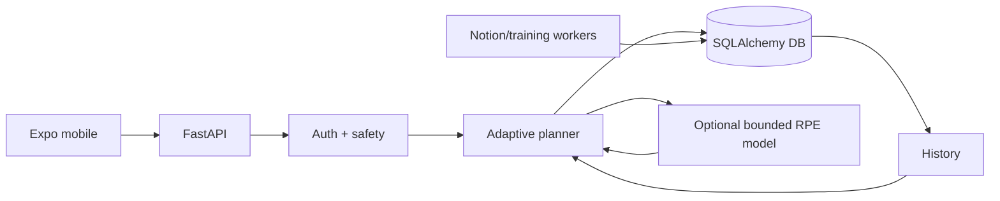

# Architecture

## Overview
Expo/React Native mobile client → authenticated FastAPI `/api/v1` services → deterministic safety/planning layer → SQLAlchemy persistence (SQLite development, PostgreSQL deployment). Optional consent-aware neural inference annotates or conservatively reduces an already-safe rules prescription; it cannot bypass safety. Background workers support collection sync/training.

## Boundaries
Client never supplies authoritative owner identity. Exercise metadata must be approved for automatic planning. Historical prescriptions are auditable snapshots. Offline mutations use stable event IDs. Secrets stay server/OS protected. Media is served through validated authenticated application paths.

## Phase 2 direction
Add a weekly schedule/programming service above session generation. It will select day intent from availability, goals, recovery, recent muscle workload and frequency constraints, then delegate exercise selection/prescription to the existing safe planner.
