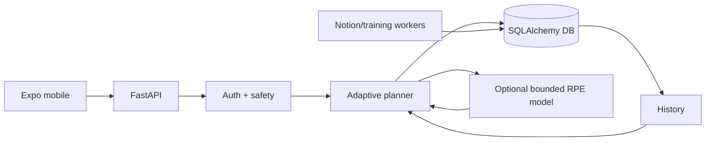

# Architecture

## Overview
Expo/React Native mobile client → authenticated FastAPI `/api/v1` services → deterministic safety/planning layer → SQLAlchemy persistence (SQLite development, PostgreSQL deployment). Optional consent-aware neural inference annotates or conservatively reduces an already-safe rules prescription; it cannot bypass safety. Background workers support collection sync/training.

## Boundaries
Client never supplies authoritative owner identity. Exercise metadata must be approved for automatic planning. Historical prescriptions are auditable snapshots. Offline mutations use stable event IDs. Secrets stay server/OS protected. Media is served through validated authenticated application paths.

## Evolve weekly programming layer
`backend/fitness/weekly.py` is a deterministic orchestration layer above session generation. It derives a Monday–Sunday schedule from `Profile.days`, completed workout snapshots and completed-set history; chooses a supported split template; carries tracked unfinished session slots forward; and summarizes muscle recency. It delegates exercise selection, progression, volume guardrails and readiness scaling to `engine.plan`.

The weekly schedule is intentionally **derived state** rather than a new authoritative schedule table in v0.3.0. Workouts remain durable snapshots in `workouts.plan`, including `session_template` and `schedule_context`, while recommendation changes remain auditable in `recommendation_decisions`. This avoids duplicating truth while the planner policy is still evolving.
